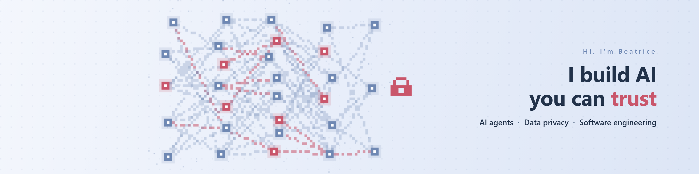
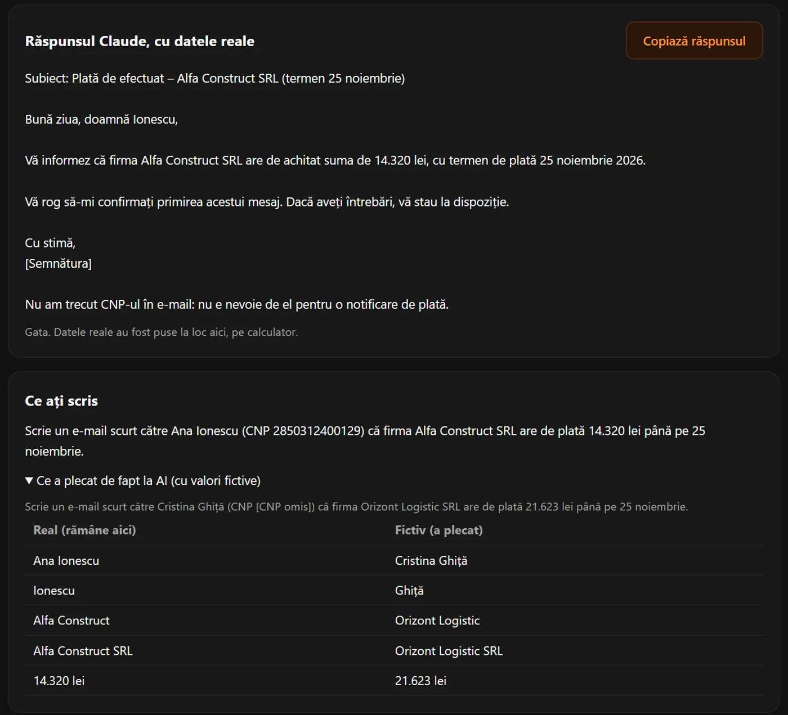

  

  
  
  

### 👋 Hi, I'm Beatrice

I work where **AI, software engineering and cybersecurity** meet. I like taking a real problem, checking that it really exists, then building something that solves it and proving that it works.

<table>
<tr>
<td width="50%" valign="top">

**🔭 Right now**
- 🎓 M.Sc. in **IT Management** at POLITEHNICA Bucharest (2026 – 2028)
- 🤖 Building **AI agents that respect private data**
- 🧠 Implementing ML algorithms **from scratch**
- 🐝 Growing **BeeDetection**, my deepfake detector

</td>
<td width="50%" valign="top">

**🏆 Highlights**
- 📘 **2 research papers** on AI, published in 2025 (Springer, Informatica Economică)
- 🏅 **Honorable mention**, ASE Student Scientific Session 2025
- 💼 **Database intern**, SQL Server & ERP (2024)
- ⚡ Built **AIrlock** in 28 hours and demoed it live

</td>
</tr>
</table>

---

### 📚 Research

- **Automating Student Attendance Using Facial Recognition Through Artificial Intelligence** · 24th International Conference on Informatics in Economy (IE 2025) · [Springer](https://link.springer.com/chapter/10.1007/978-981-95-6136-0_38)
- **Exploring Conversational Programming through the CHOP Paradigm and Artificial Intelligence** · Informatica Economică, Vol. 29, No. 2/2025 · [DOI](https://doi.org/10.24818/issn14531305/29.2.2025.01)
- **Deepfake and the cybersecurity paradigm: fighting digital disinformation with AI** · ASE Student Scientific Session 2025 · 🏅 honorable mention

---

### 🔐 Featured: AIrlock, nothing leaves unfiltered

<table>
<tr>
<td width="55%" valign="top">

A local agent that sits between employees and ChatGPT or Claude. When you hit **Send**, it replaces names, national IDs and amounts with consistent fake values, then puts the real ones back in the AI's answer. Documents that are too sensitive never leave: they open in a **local LLM** instead.

**Built in 28 hours** at an AI validation bootcamp, after surveying 31 people. Demoed live on ChatGPT and Claude:

> **0** real records reached the AI, across 9 messages full of personal data and 5 attempts to upload a financial report.

`mitmproxy` · `Protobuf` · `Ollama` · `EasyOCR` · `spaCy` · `MCP` · `346 tests` · *(private repo)*

</td>
<td width="45%" valign="top">

</td>
</tr>
</table>

---

### 🧰 Tech I work with

**AI & ML**

  
  
  
  
  
  
  
  
  
  

**Languages**

  
  
  
  
  
  
  
  

**Building products**

  
  
  
  
  
  
  
  

**Security & privacy**

  
  
  
  

---

### 🐝 BeeDetection · deepfake detection

My bachelor's thesis, grown into a full platform: it analyzes images and video (including the audio track) with pretrained deep networks (XceptionNet, VGG-Face, EfficientNetV2), explains every verdict with **Grad-CAM heatmaps** and exports a PDF report. Runs on the web and as a **Chrome extension** that checks content in real time.

`TensorFlow` · `Keras` · `OpenCV` · `Librosa` · `React` · `Node.js` · `Express` · `MySQL` · `JWT` · `Chrome MV3` · *(private repo)*

---

### 🧠 AI built from scratch

| Project | What it does |
|---|---|
| [Neural network](https://github.com/pastinicabeatrice/retea-neuronala-numpy) | Multilayer perceptron with backpropagation, NumPy only |
| [Q-learning agent](https://github.com/pastinicabeatrice/q-learning-python) | Learns by trial and error to escape a maze full of traps |
| [Eigenfaces](https://github.com/pastinicabeatrice/pca-face-recognition) | Face recognition with PCA + SVM |
| [Spam classifier](https://github.com/pastinicabeatrice/clasificator-spam-naive-bayes) | Multinomial Naive Bayes, no libraries |
| [Genetic algorithm](https://github.com/pastinicabeatrice/algoritm-genetic-python) | Packs the most valuable bag under a weight limit |
| [Unbeatable tic-tac-toe](https://github.com/pastinicabeatrice/tic-tac-toe-minimax) | Minimax opponent in the browser that never loses |

<a href="https://pastinicabeatrice.github.io"><b>See all projects on my portfolio →</b></a>

